<p align="center">
  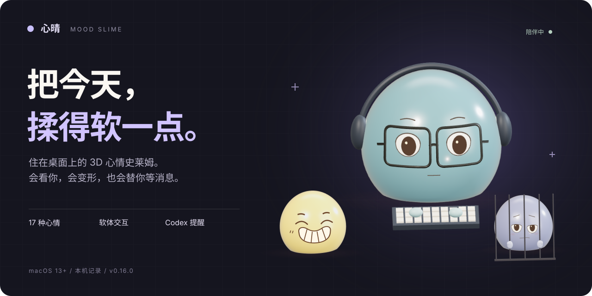
</p>

<p align="center">
  <strong>一团有心情的软糯小东西，陪你待在桌面上。</strong><br>
  捏一捏，换个心情。让它陪你写代码，也替今天留下一点颜色。
</p>

<p align="center">
  <strong>macOS 13+</strong> &nbsp; / &nbsp; <strong>真实 3D</strong> &nbsp; / &nbsp; <strong>17 种心情</strong> &nbsp; / &nbsp; <strong>本机存储</strong>
</p>

<p align="center">
  <a href="#moods">认识它</a> · <a href="#play">桌面怎么玩</a> · <a href="#start">启动心晴</a> · <a href="#codex">Codex 提醒</a> · <a href="#development">开发与验证</a>
</p>

---

<a id="moods"></a>
## 今天，你是哪一颗？

开心时露出大牙，平静时扶好眼镜；困了有黑眼圈，累了连身体也会塌一点。每种心情都有自己的五官、颜色和神态。

下面都是 **0.16.0 应用里的真实三维渲染**。点击图片可以查看透明 PNG 原图。

<table>
  <tr>
    <td align="center"><a href="docs/assets/mood-slacking.png">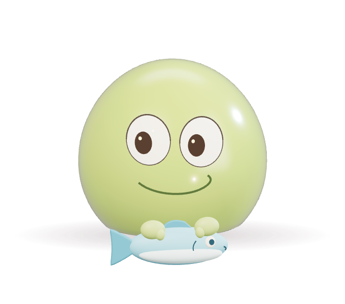</a><br><strong>摸摸鱼</strong><br><sub>鱼是真的，忙是装的</sub></td>
    <td align="center"><a href="docs/assets/mood-confident.png">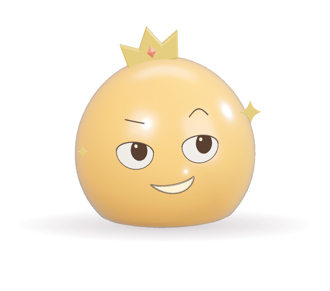</a><br><strong>当红炸子鸡</strong><br><sub>现在正是我的主场</sub></td>
  </tr>
</table>

<table>
  <tr>
    <td align="center"><a href="docs/assets/mood-calm.png">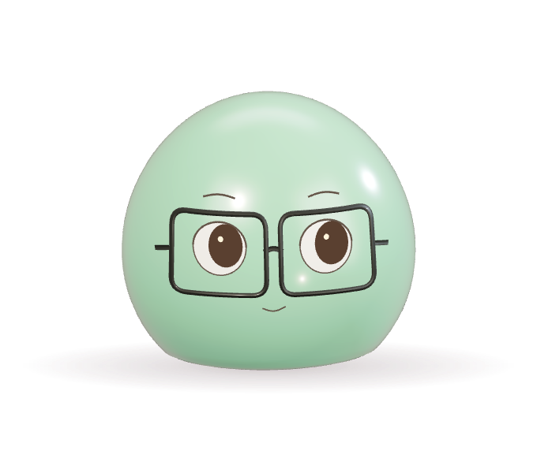</a><br><strong>平静</strong><br><sub>稳稳地待着</sub></td>
    <td align="center"><a href="docs/assets/mood-happy.png">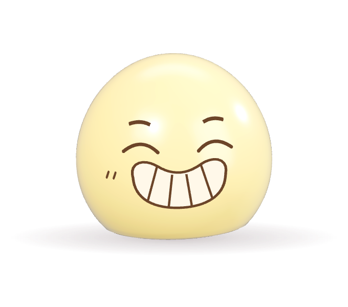</a><br><strong>开心</strong><br><sub>藏不住一点</sub></td>
    <td align="center"><a href="docs/assets/mood-sad.png">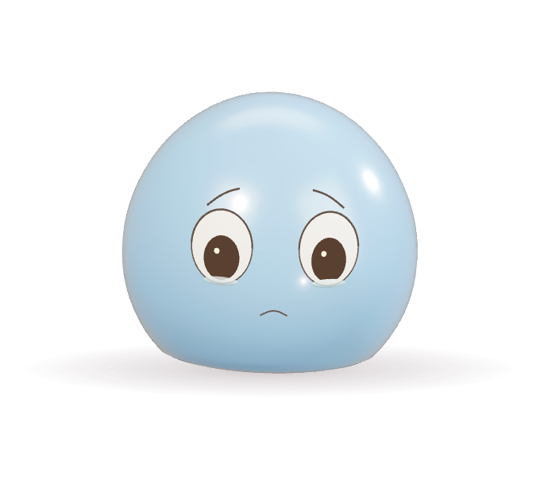</a><br><strong>难过</strong><br><sub>先陪我一会儿</sub></td>
    <td align="center"><a href="docs/assets/mood-anxious.png">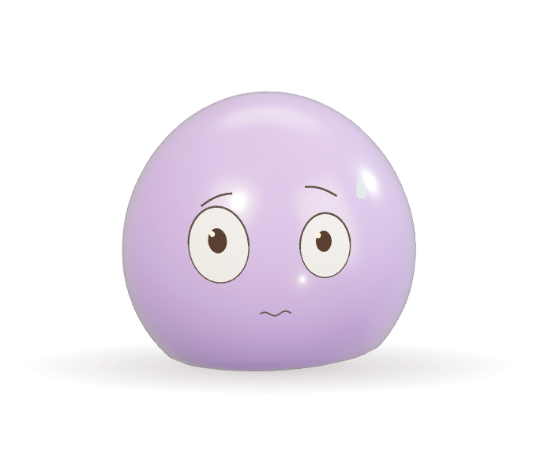</a><br><strong>焦虑</strong><br><sub>眼神开始乱跑</sub></td>
    <td align="center"><a href="docs/assets/mood-angry.png">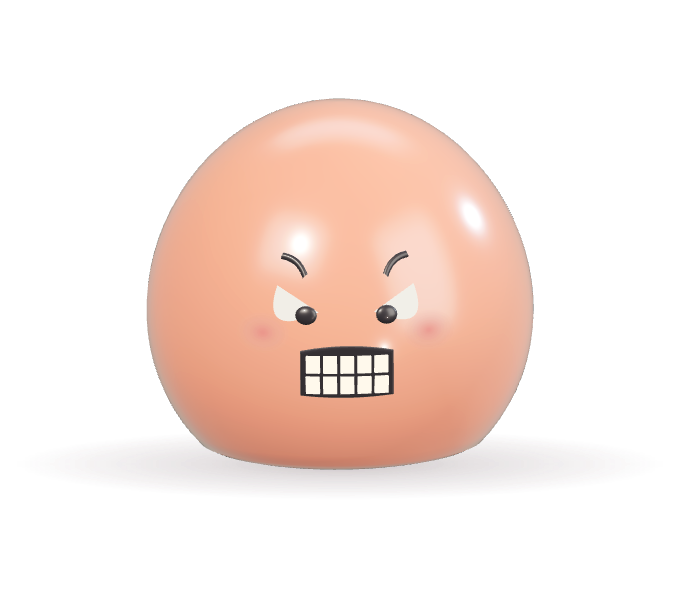</a><br><strong>烦躁</strong><br><sub>现在有点炸</sub></td>
  </tr>
  <tr>
    <td align="center"><a href="docs/assets/mood-tired.png">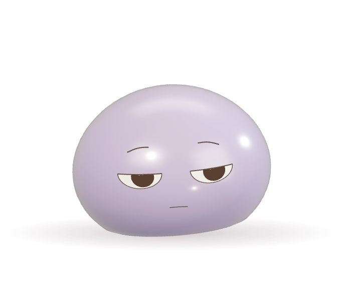</a><br><strong>轻微疲惫</strong><br><sub>电量告急</sub></td>
    <td align="center"><a href="docs/assets/mood-verytired.png">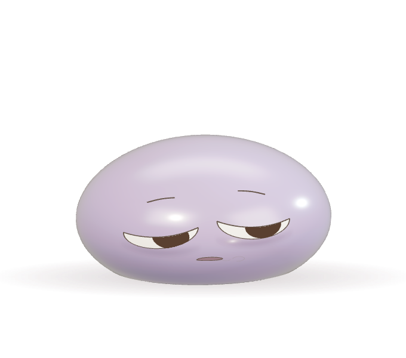</a><br><strong>非常疲惫</strong><br><sub>电量见底</sub></td>
    <td align="center"><a href="docs/assets/mood-sleepy.png">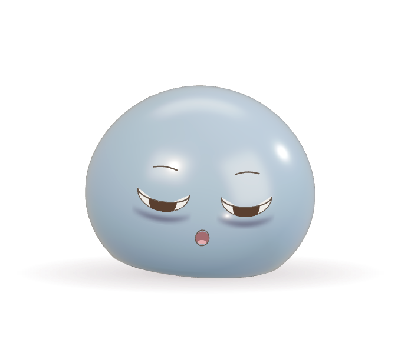</a><br><strong>好困</strong><br><sub>眼皮在下班</sub></td>
    <td align="center"><a href="docs/assets/mood-resigned.png">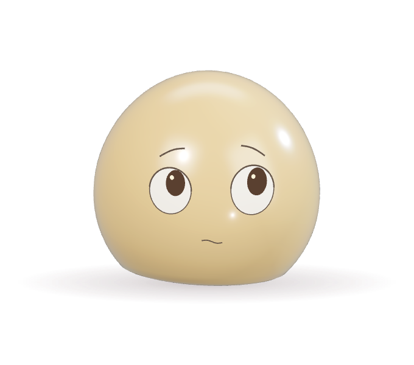</a><br><strong>无奈</strong><br><sub>行吧，还能怎样</sub></td>
    <td align="center"><a href="docs/assets/mood-speechless.png">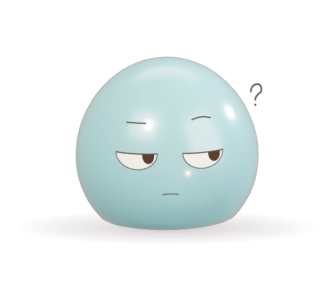</a><br><strong>无语</strong><br><sub>缓缓打出一个问号</sub></td>
  </tr>
  <tr>
    <td align="center"><a href="docs/assets/mood-headache.png">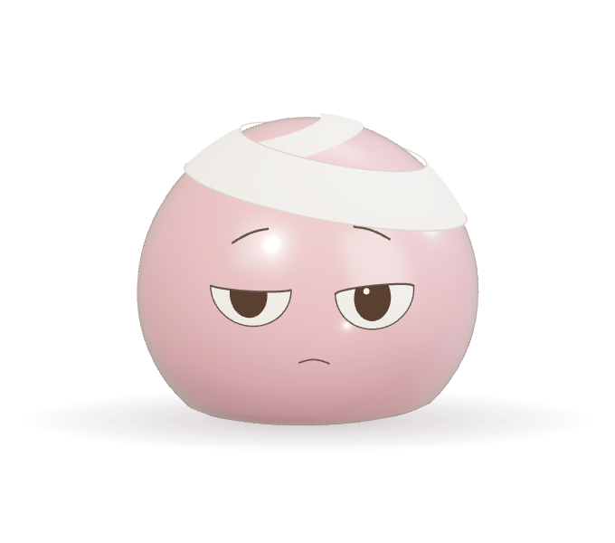</a><br><strong>头痛</strong><br><sub>脑袋需要缓一缓</sub></td>
    <td align="center"><a href="docs/assets/mood-sick.png">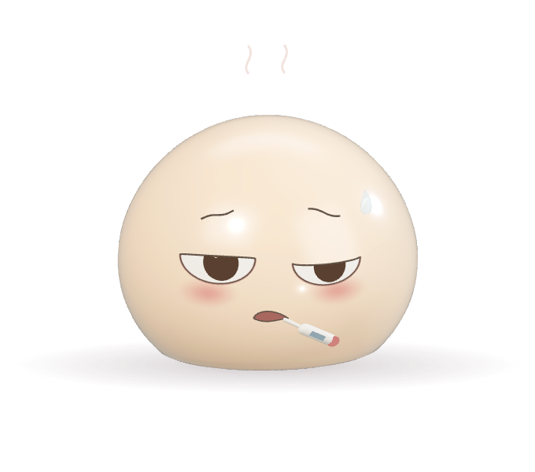</a><br><strong>生病</strong><br><sub>今天慢一点</sub></td>
    <td align="center"><a href="docs/assets/mood-overwhelmed.png">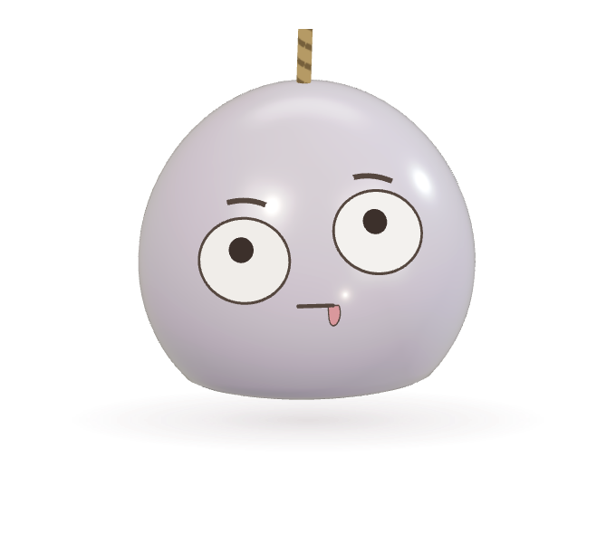</a><br><strong>要死了</strong><br><sub>灵魂暂时离线</sub></td>
    <td align="center"><a href="docs/assets/mood-coding.png">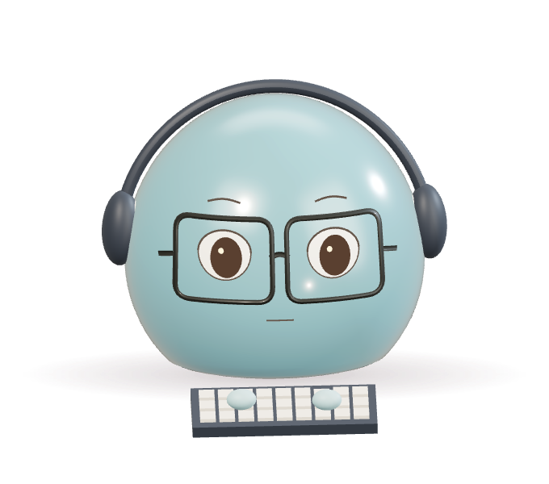</a><br><strong>沉浸开发</strong><br><sub>正在进入心流</sub></td>
    <td align="center"><a href="docs/assets/mood-jailed.png">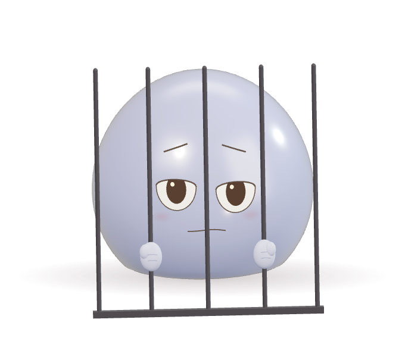</a><br><strong>坐牢</strong><br><sub>人还在，心已下班</sub></td>
  </tr>
</table>

<a id="play"></a>
## 小小一团，摸得到的回应

它有真正的三维身体、光照和软体形变。按住会压扁，拉动会伸长，松手再弹回来；捏疼了会贴上小绷带。五官随着身体变化，眼睛会看向鼠标，也会自然眨眼。

新增的「摸摸鱼」会把一条小蓝鱼放在身前：一只手扶着，一只手轻轻摸，鱼尾也会轻摆。按住揉捏或启用减少动态时，摸鱼动作暂停。「当红炸子鸡」则戴上小金冠，挑眉露出得意笑容，旁边的小星光轻轻闪动。

| 想做什么 | 怎么操作 |
| :--- | :--- |
| 捏一捏、拉一拉 | 按住小球压扁，继续拖动拉伸，松手回弹 |
| 摸摸它 | 右键 → **摸摸它** |
| 把它搬到别处 | **Option + 拖动**；或右键 → **移动小球（下次拖动）** |
| 调整大小 | 滚轮、触控板捏合，或右键选择大小 |
| 换个心情 | 右键 → **换个心情并记录** |
| 找回小球 | 菜单 → **找回小球（默认大小）** |
| 看今天的记录 | 右键 → **打开心情日历** |
| 换上自己的形象 | 右键 → **设置 → 换个模样…** |

透明桌面小窗默认 **170 × 150**，可置顶、跨桌面显示，并在全屏应用上方陪伴。开启 **跟随鼠标** 后，它会跟到鼠标所在的显示器；关闭后，就留在你手动放置的位置。

支持 PNG、JPEG、WebP、GIF、APNG 皮肤。导入图片或动图后，形象也能跟着变形；图片不会自动变成新的三维模型。系统启用减少动态效果时，小球会减少自主动作。

## 给一天留一条颜色的轨迹

**09:10 平静 → 11:35 焦虑 → 15:20 沉浸开发 → 18:05 开心**

心情可以一天换好多次。时间轴按分钟查看，记录保留实际时间，还能写一句只给自己看的话。

- **记录当下**：日历里选心情、写留言，点击「记下此刻」。只预览表情不会新增记录；桌面菜单中的「换个心情并记录」会直接保存。
- **回看一天**：在时间轴上查看各段心情、切换时间及对应留言，月历呈现每天的颜色。
- **跨过午夜**：归档已有记录的每日回顾；应用没开着时，下次启动补齐遗漏的归档。
- **带走记录**：可以导出 JSON。没有记录的时间会留空，不替你猜测心情。

<a id="codex"></a>
## 你写代码，它替你等消息

可选的本机 Codex 通知桥接，会让小球带来一张随心情变色的小纸条：

| Codex 发生了什么 | 小球收到什么 |
| :--- | :--- |
| 任务完成 | 完成提醒 |
| 等待批准 | 待批准提醒 |
| 有问题需要回答 | 待回答提醒 |

完成提醒会尝试依据本机 Codex 的逐会话、逐回合已读回执清除；待批准和待回答提醒保留，也可以点「都看过了」手动清理。

桥接是**可选组件**，不影响独立使用心情日历。相关入口见 [`scripts/install_codex_hooks.py`](scripts/install_codex_hooks.py) 和 [`scripts/codex_pet_hook.py`](scripts/codex_pet_hook.py)。配置会涉及用户级 hooks，使用前请阅读脚本，并在 Codex 中审阅、信任对应定义。

> 已读同步依赖 Codex 客户端内部格式与 hook 支持，存在版本兼容限制。缺少回执时会保留提醒；小球不会替你执行批准，也不修改 Codex 数据库。当前没有接入飞书或微信通知。

<a id="start"></a>
## 把它带到桌面

当前版本 **0.16.0**。支持 **macOS 13+**，需要 Git 和 Xcode Command Line Tools。应用使用 AppKit、WKWebView 与仓库内的 Three.js，构建无需安装 npm 依赖。

在终端执行：

```sh
git clone https://github.com/guP0an/mood-slime.git
cd mood-slime
bash build.sh
open 'dist/心晴.app'
```

启动后点击 **「放到桌面」**。下次也可以直接双击 `dist/心晴.app`。

已经有这份仓库，只想叫它出来：

```sh
open 'dist/心晴.app' --args --show-pet
```

构建产物采用本机临时签名，尚未进行 Apple 公证。仓库提供源码，未附带已公证的安装包；目前不支持 Windows 或 Linux。

<details>
<summary><strong>记录存在哪里？升级和备份要注意什么？</strong></summary>

存档目录：

```text
~/Library/Application Support/MoodSlime/
```

这里包含 `moods.json`、备份和皮肤图集。备份时保存整个目录；不要通过删除存档来修复界面问题。

旧记录可以继续使用。记录过新状态后，较老版本可能不认识新增的状态标识，例如「坐牢」和 0.16.0 新增的「摸摸鱼」「当红炸子鸡」；降级前请核对版本兼容性。

心情记录保存在本机。通知桥接处理生命周期标识与本地聊天标题，不存储消息正文。仓库中的展示图片来自合成测试，仅含三维角色，不含真实聊天或心情记录。

</details>

<a id="development"></a>
## 拆开看看

```text
AppKit 原生窗口与菜单
         ↕ 本机消息桥接
WKWebView · 心情日历 + Three.js 小球
         ↕
本机 JSON 存档 / 可选 Codex 通知桥接
```

| 位置 | 负责什么 |
| :--- | :--- |
| [`App.m`](App.m) | 原生窗口、桌面菜单、WebKit 桥接与通知界面 |
| [`Store.m`](Store.m) | 存档校验、原子保存、备份与图片解码 |
| [`CodexAlerts.m`](CodexAlerts.m) | 本地通知事件读取、去重及已读状态处理 |
| [`web/`](web/) | 心情日历、三维角色、五官和软体物理 |
| [`scripts/`](scripts/) | 可选 Codex 通知桥接及配置工具 |
| [`tests/`](tests/) | 模型、物理、通知与原生回归检查 |

<details>
<summary><strong>运行检查</strong></summary>

模型与物理检查需要 Node.js，通知脚本检查需要 Python 3。原生界面检查需要解锁且可见的 macOS 桌面，会使用临时合成存档。

```sh
node tests/model.cjs
node tests/physics.cjs
node tests/expression.cjs
node tests/expression-mesh.cjs
python3 tests/codex-hook.py
bash build.sh
'dist/心晴.app/Contents/MacOS/MoodSlime' --storage-test
open -n -W 'dist/心晴.app' --args --self-test --artifacts "$PWD/outputs/self-test"
codesign --verify --deep --strict 'dist/心晴.app'
```

查看 `outputs/self-test/integration.json` 中的实际结果。仓库目前未配置远端 CI；本机检查不代表其他系统版本、所有多屏布局或长期功耗均已验收。

</details>

Three.js 的版本、来源与第三方许可见 [`PROVENANCE.json`](web/vendor/PROVENANCE.json) 和 [`THREE-LICENSE.txt`](web/vendor/THREE-LICENSE.txt)。

---

<p align="center">
  <strong>今天是什么心情，都可以先在这里待一会儿。</strong><br>
  <sub>心晴 · Mood Slime</sub>
</p>
